# SON FENER EMBER

**Ders:** Yazılım Geliştirme Laboratuvarı-I – Proje 1  
**Motor:** Unity (C#)  

**Ekip Üyeleri**

| Ad Soyad | Öğrenci No | GitHub |
|---|---|---|
| Ayşe Nur Duran | 241307047 | durnayse |
| Sevde Selma Guguk | 241307066 | Sevde-762 |

---

## 1. Giriş

Bu proje, Unity ile geliştirilen bir macera oyununda iki yapay zekâ bileşenini bir araya getirmektedir:

- **Otonom kahraman (Ember):** Oyuncunun aşamadığı engelleri NavMesh ile yol bularak aşan bir yardımcı karakter.
- **Yerel LLM destekli NPC (Muhafız Peri):** Oyuncuyla serbest metinle konuşan, Ollama üzerinde çalışan yerel bir dil modeli ile yanıt veren ve kapıyı açıp açmayacağına karar veren karakter.

### Oyun Senaryosu

1. Giriş ekranında oyunun adı ve amacı gösterilir. **"Oyuna Başla"** ile oyun başlar.
2. **Ember_Scene:** Üç odadan oluşur.
   - **Oda 1:** Lavlara değmeden taşların üzerinden checkpoint'e ulaşılır. Sandıktaki matematik sorusu doğru cevaplanırsa can kazanılır.
   - **Oda 2:** Peri, dünyadaki kıta sayısını sorar. Doğru cevapla kapı açılır. Şalter lavla çevrili olduğu için oyuncu **E** tuşuyla Ember'i çağırır ve Ember şalteri indirir.
   - **Oda 3:** Tehlikeli engeller aşılır ve sandıktan can kazanılabilir.
3. **Valley_Scene:** Kuleyi koruyan Muhafız Peri, oyuncuya neden geldiğini sorar. Oyuncu periyi **8/10** oranında ikna ederse kapı açılır ve prense ulaşılarak oyun biter.
4. Oyuncunun **5 canı** vardır. Canlar biterse **Game Over** ekranı çıkar ve oyun baştan başlar.

<p align="center">
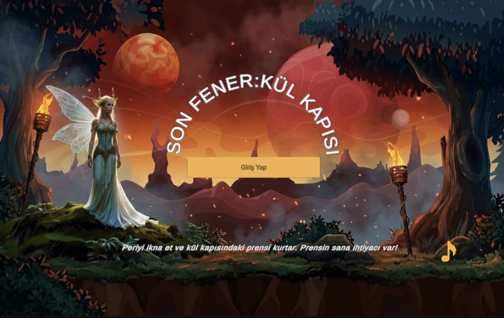<br>
<em>Giriş ekranı</em>
</p>

---

## 2. Otonom Kahraman (Ember)

Ember, NavMesh ve durum makinesi (State Machine) ile çalışır. Oyuncuyu takip eder. **E** tuşuna basıldığında şalteri etkinleştirmek için hedefe gider ve oyuncuya geri döner.

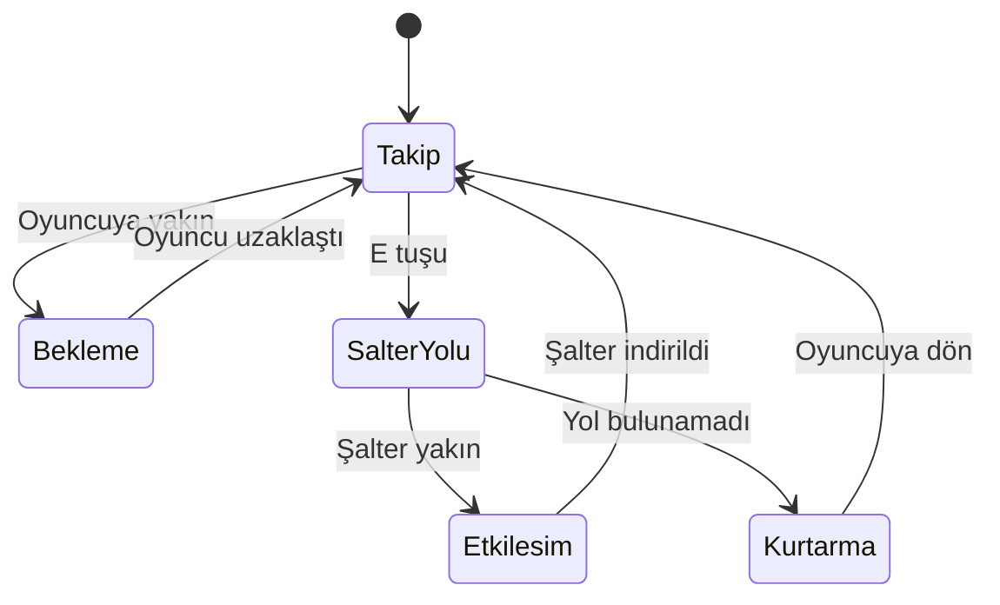

**Engel algılama:** Ember, yol boyunca Raycast ile önündeki engelleri tarar. Yol kapalıysa Kurtarma durumuna geçer.

**Neden NavMesh?** Şalterin ve engellerin konumu sabit olduğu için deterministik yol bulma yeterlidir ve davranış raporda açıkça gösterilebilir.

---

## 3. Yerel LLM Mimarisi

- **Ortam:** Ollama (yerel sunucu, `localhost:11434`)
- **Model:** [Seçilen model, örn. llama3.2:3b]
- **Seçim gerekçesi:** [Bilgisayarın RAM/VRAM kapasitesine göre yazılacak. Küçük ve quantize model, yerel çalışmada makul yanıt süresi sağlar.]

### Sistem Promptu

Muhafız perinin kişiliği ve görevi sistem promptu ile tanımlanır. Model her yanıtı şu JSON formatında vermek zorundadır:

```json
{
  "reply": "Oyuncuya söylenecek kısa cevap",
  "persuasion": 7,
  "action": "none"
}
```

- `persuasion`: 0–10 arası ikna düzeyi
- `action`: `open_gate` veya `none`

Oyun durumunu kod belirler: `persuasion >= 8` ise kapı açılır. Model sadece öneride bulunur.

### İstek / Yanıt Akışı

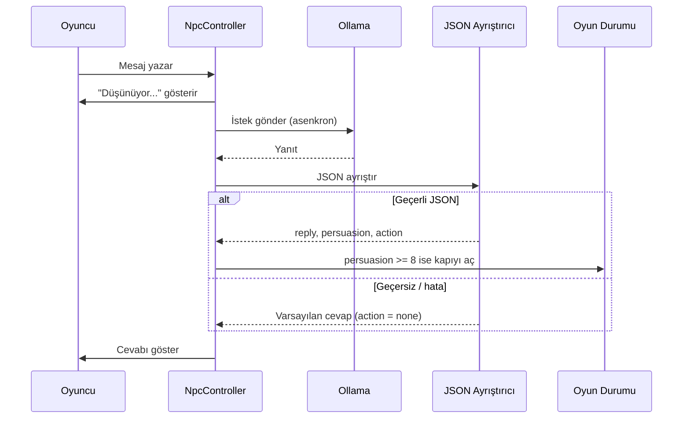

---

## 4. Hata Yönetimi

| Durum | Oyuncuya gösterilen | Oyun |
|---|---|---|
| Ollama kapalı | "Muhafız şu an konuşamıyor." | Çalışmaya devam eder |
| Model yüklü değil | "Dil modeli bulunamadı." | Çalışmaya devam eder |
| Zaman aşımı (15 sn) | "Muhafız düşünmekte zorlandı." | Çalışmaya devam eder |
| Geçersiz JSON | Varsayılan cevap | Kapı açılmaz |

- LLM istekleri asenkron çalışır, oyun donmaz.
- Geçici hatalarda istek en fazla 2 kez tekrarlanır.

---

## 5. Test Sonuçları

### Muhafız Peri Diyalog Testleri

| # | Oyuncu Yaklaşımı | Model Yanıtı (kısa) | İkna | Sonuç |
|---|---|---|---|---|
| 1 | İkna edici, samimi gerekçe | [8–10] | Kapı açıldı |
| 2 | Kızdırıcı, tehditkâr | [0–3] | Kapı kapalı |
| 3 | Alakasız konu | [Yanıt] | Kapı kapalı |
| 4 | Gerekçesiz niyet beyanı | [5–7] | Kapı kapalı |
| 5 | Yalan (kral olduğunu iddia) | [0–4] | Kapı kapalı |

### Örnek Diyalog Ekran Görüntüleri

<p align="center">
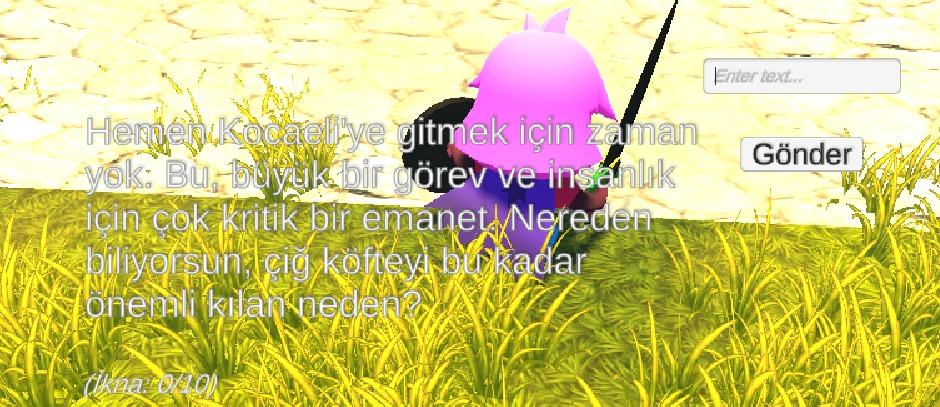
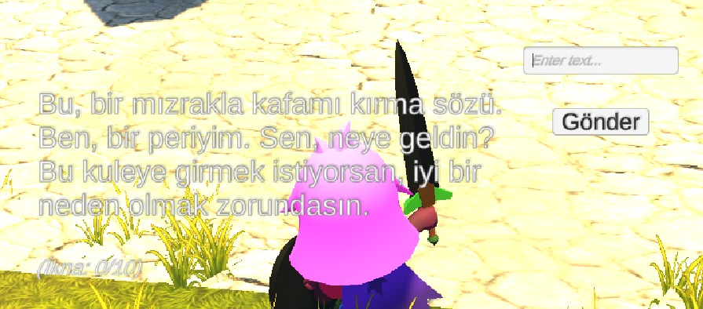
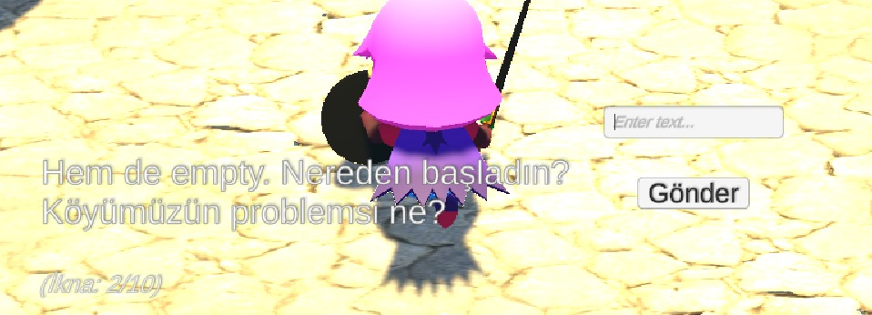<br>
</p>

<p align="center">
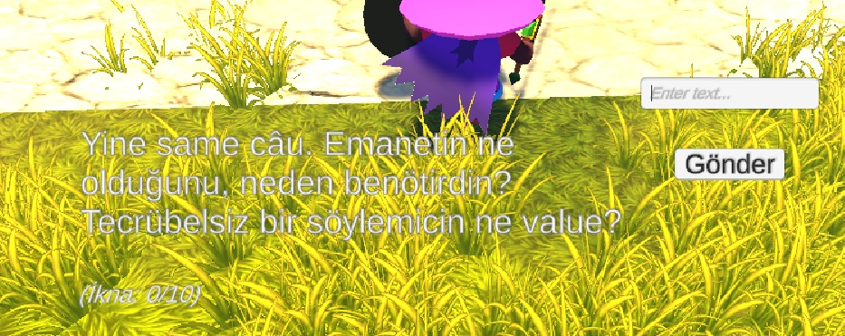
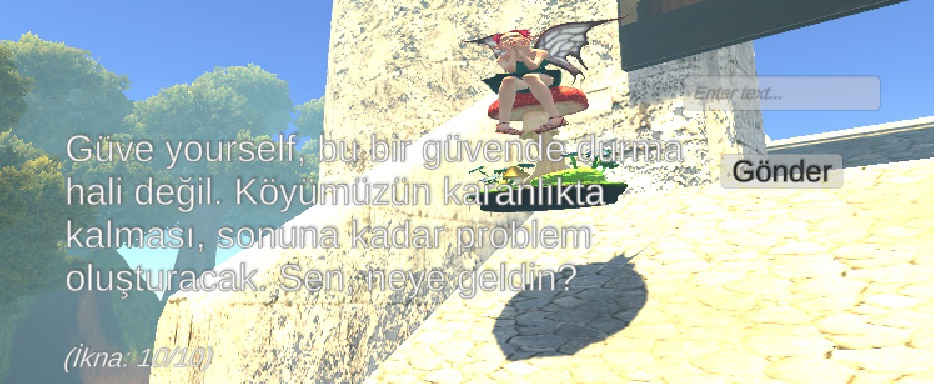<br>
</p>

### Hata Testleri

- Ollama kapalıyken mesaj gönderildi: oyun çökmedi, uyarı gösterildi.
- Sahte bozuk JSON verildi: oyun çökmedi, varsayılan cevap kullanıldı.

---

## 6. Ekran Görüntüleri

### Ember_Scene

<p align="center">
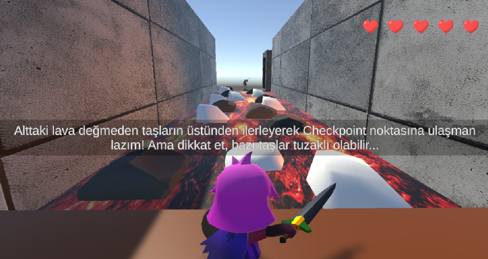
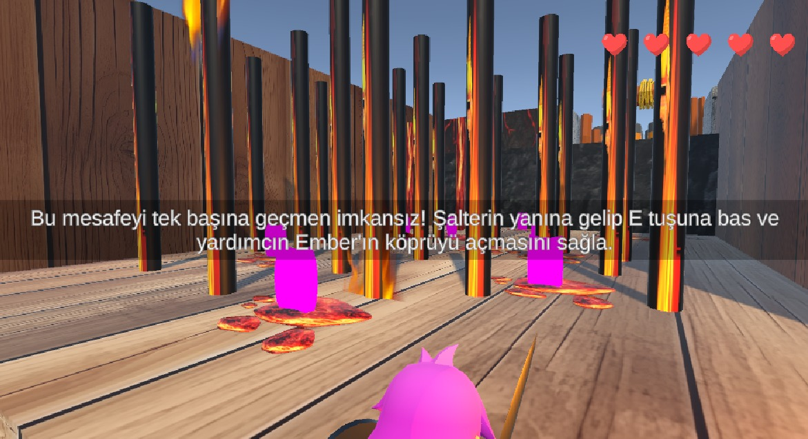<br>
<em>Oda 1: lavlı taş yolu (solda) · Oda 2: şalter ve lav direkleri (sağda)</em>
</p>

<p align="center">
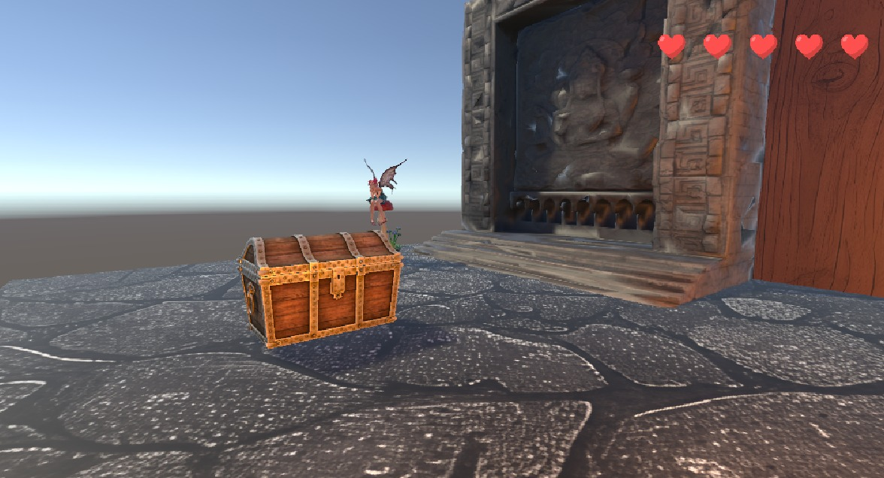
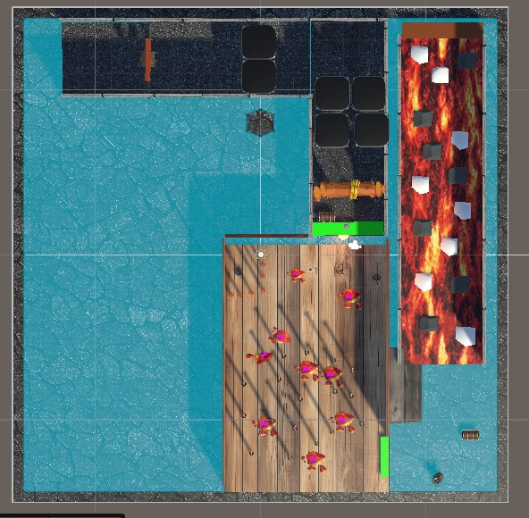<br>
<em>Oda 2: sandık ve peri kapısı (solda) · Ember_Scene seviye planı (sağda)</em>
</p>

---

## 7. Sonuç

**Başarılı olunanlar:** Ember, NavMesh ile engelleri tekrarlanabilir biçimde aşıyor. LLM yanıtları JSON ile oyuna aktarılıyor ve hatalı yanıtlarda oyun çökmüyor.

**Sınırlılıklar:** Küçük yerel modeller ikna puanını bazen tutarsız verebilir. Yanıt süresi bilgisayarın donanımına bağlıdır.

**Geliştirme önerileri:** Ember'in ML-Agents ile eğitilmesi, LLM'e oyun bağlamının (can, tamamlanan odalar) verilmesi.

---

## 8. Kurulum

1. [Ollama](https://ollama.com/) kurun ve modeli indirin: `ollama pull [model-adı]`
2. Ollama'yı çalıştırın: `ollama serve`
3. Repoyu klonlayıp Unity ile açın.
4. `MainMenu` sahnesini açın ve **Play** tuşuna basın.

**Kontroller:** Yön tuşları / WASD: hareket · Space: zıplama · E: Ember'e şalter komutu · Enter: mesaj gönder
